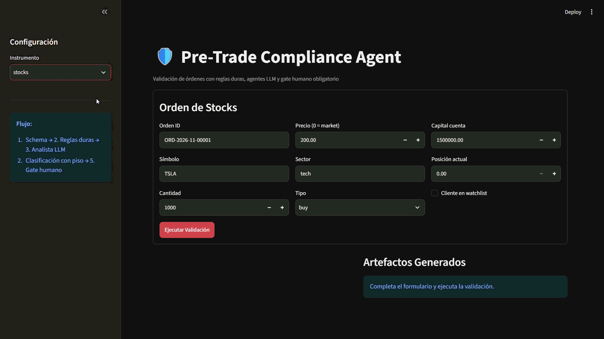
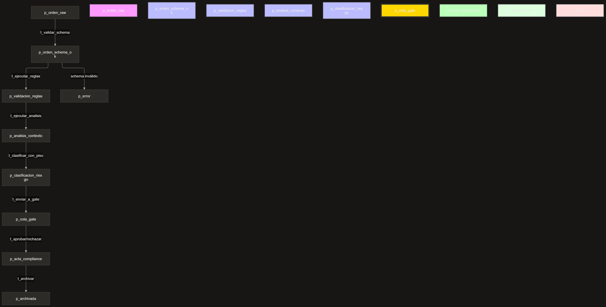

# Pre-Trade Compliance Agent (multi-agente)

> Sistema agéntico para la validación de órdenes financieras (stocks, forex,
> crypto, futures, opciones) contra reglas duras deterministas, análisis de
> contexto por agentes LLM acotados, y gate humano obligatorio.
> **Este sistema NO ejecuta órdenes, solo las audita y recomienda.**



## El problema

En mesas institucionales y brokers, un Compliance Officer revisa manualmente
cientos de órdenes al día. Debe cruzar límites de posición, listas de
restricción, concentración sectorial y patrones de wash trading. Es lento
(3-5 min por orden), propenso a errores por fatiga y difícil de auditar de
forma consistente. Además, el contexto del cliente (si está en watchlist,
si tiene un patrón inusual) a menudo se pasa por alto.

## La solución

Un motor de **red de Petri** orquesta el flujo: pre-filtra con reglas duras
(scripts deterministas), pasa las órdenes que superan el filtro por agentes
LLM acotados (analista y redactor), y un humano (gate obligatorio) aprueba
o rechaza. La IA nunca puede anular una regla dura.

**Resultado**: 70% de las órdenes triviales se auto-clasifican con log; el
30% restante pasa por agentes LLM y gate humano. Tiempo: 30 segundos por
orden trivial, 2 minutos por orden compleja. Riesgo: clasificación consistente
y auditable con trazabilidad completa.

## 🏗️ Arquitectura de Software

El sistema está diseñado bajo el patrón de **"Workflow-oriented multi-agent patterns" (Patrones multiagente orientados a flujos de trabajo)**, alineado con los estándares de la industria definidos por Microsoft Azure Architecture Center y AWS Prescriptive Guidance.

Este patrón es apropiado para procesos que requieren **orden estricto, cumplimiento de reglas de negocio y auditabilidad completa**, como es el caso de la validación pre-trade en compliance financiero.

La arquitectura implementa un **motor de workflow determinista** que separa estrictamente el **motor de control** (que dicta qué transición se ejecuta) de la **lógica de negocio** (reglas y agentes). El flujo es determinista: las transiciones se habilitan por la presencia de **permisos** en sus etapas de entrada, y las guardas deciden si la ejecución se permite. La IA nunca tiene el control del flujo; solo produce contenido acotado dentro de una transición.



**Componentes de la Arquitectura:**

- **Motor de Workflow (Orquestador):** El motor que dicta las transiciones. Es puramente determinista y no usa IA. Modela concurrencia, competencia por recursos y bloqueos de forma estructural.
- **Motor de Reglas (Scripts):** Validaciones duras e inmutables. 25 reglas deterministas (5 por instrumento) que se ejecutan sin intervención de IA.
- **Agentes LLM (acotados):** Funciones deterministas con un LLM detrás. El **analista** analiza contexto no estructurado; el **redactor** redacta el memo de compliance. Ninguno tiene agencia autónoma ni control del flujo.
- **Clasificador (determinista):** Script que aplica el **piso de reglas duras** y produce la clasificación final. No es un LLM: la IA no puede anular el piso.
- **Guardas (Guardrails):** Controles de seguridad que validan las transiciones (piso de reglas duras, hash de inputs, exclusión mutua del gate, idempotencia del archivado). Cada paso del workflow tiene precondiciones y postcondiciones explícitas.
- **Gate Humano:** Interfaz de decisión final con firma digital. Obligatorio para riesgo >= MEDIUM, implementando el patrón de *human-in-the-loop* recomendado para procesos de compliance.

### Los Agentes (LLM vía API)

Los agentes de análisis y redacción **no son agentes autónomos**. Son **funciones deterministas con un LLM detrás**, siguiendo el principio de "workflows" de Anthropic: estructura determinista, el LLM hace el trabajo de contenido en cada paso.

#### ¿Qué significa "no son autónomos"?

En sistemas agénticos, un **agente autónomo** es aquel que decide qué hacer a continuación (elige la siguiente acción o herramienta), puede iterar sin intervención humana, tiene control del flujo y puede encadenar múltiples llamadas (tool calling). Ejemplos: un agente ReAct que itera "pienso → actúo → observo" hasta resolver una tarea, o un agente de LangChain que decide qué API llamar.

Tus agentes **no hacen nada de eso**. Son funciones deterministas con un LLM detrás:

| Característica | Agente autónomo | Tu agente (analista/redactor) |
|:---|:---|:---|
| ¿Decide qué hacer después? | Sí | **No**. El workflow decide. El agente solo ejecuta su tarea cuando la transición se dispara. |
| ¿Itera? | Sí (ReAct, tool calling) | **No**. Una sola llamada HTTP. Si falla, reintenta (hasta 3 veces), pero no cambia de estrategia. |
| ¿Tiene control del flujo? | Sí | **No**. El motor de workflow dicta cuándo se ejecuta y qué hacer con el output. |
| ¿Usa herramientas? | Sí (tool calling) | **No**. Solo recibe un prompt y devuelve un JSON (analista) o texto libre (redactor). |
| ¿Puede encadenar llamadas? | Sí | **No**. Una llamada por transición. |
| ¿Puede decidir terminar? | Sí | **No**. El workflow decide cuándo termina (archivado, gate, error). |

**¿Por qué es importante para compliance?** Porque no quieres que un LLM decida el flujo. Si el agente pudiera decidir "voy a saltarme la regla R1 porque creo que no aplica", estarías dando a la IA el control de una decisión safety-critical. Eso es exactamente el anti-patrón que el proyecto evita. Al hacer que los agentes sean no autónomos:

1. **La IA solo produce contenido** (un análisis, un memo), no decisiones de flujo.
2. **El workflow determinista decide** qué se hace con ese contenido (aplicar el piso, enviar a gate, archivar).
3. **La guarda de piso es estructural**: aunque el agente "sugiera" riesgo LOW, el script determinista lo sube a HIGH si las reglas fallaron. La IA no puede anular eso.

**La analogía**: piensa en un **analista junior** en una mesa de compliance. Un agente autónomo sería un junior que decide por sí mismo qué hacer, a quién llamar, cuándo escalar (útil, pero peligroso en compliance). Tu agente es un junior que solo hace la tarea que le pides (analizar este caso, redactar este memo) y devuelve el resultado a su supervisor (el workflow), que decide qué hacer con él. El junior no tiene autonomía para cambiar el proceso; solo ejecuta su parte. Eso es lo que hace el sistema auditable y seguro.

#### Detalles técnicos

- **Modelo:** Realizan una única llamada HTTP a un proveedor compatible con OpenAI (por defecto `glm-4.7-flash` vía Z.ai, o `deepseek/deepseek-r1:free` vía OpenRouter, o `gpt-4o-mini` vía OpenAI). El proveedor se selecciona con `LLM_PROVIDER` en `.env`.
- **Contrato:** El prompt fuerza al modelo a devolver un JSON estricto (`response_format={"type": "json_object"}`), validado contra nuestro schema Pydantic. El redactor devuelve texto libre (memo markdown), sin schema estructurado.
- **Desacoplamiento:** El cliente del LLM (`src/agents/llm_client.py`) está aislado. Si mañana migramos a Anthropic, a un modelo local (Llama 3) o a Azure OpenAI, el motor de workflow y las guardas no necesitan cambiar una sola línea de código.
- **Contención:** El agente LLM solo sugiere un `riesgo_sugerido_por_agente`. El script determinista (`clasificar_con_piso_action`) aplica el piso de reglas duras y produce la clasificación final. La IA nunca puede bajar el riesgo si las reglas fallaron. Esto sigue el principio de "validar el output del agente antes de pasarlo al siguiente paso" recomendado por Azure Architecture Center.

## Decisiones de diseño (ADRs)

| ADR | Decisión |
|:---|:---|
| [001](docs/adr/001-orquestador-determinista.md) | Orquestador determinista en vez de agente orquestador |
| [002](docs/adr/002-script-vs-agente.md) | Script para clasificación base, agente solo para contexto |
| [003](docs/adr/003-piso-reglas-duras.md) | Piso de reglas duras (la IA no puede bajar el riesgo) |
| [004](docs/adr/004-gate-humano.md) | Gate humano obligatorio y conflicto de interés |
| [005](docs/adr/005-artefactos-schema.md) | Artefactos como contratos inmutables |
| [006](docs/adr/006-hash-inputs.md) | Hash de inputs para evitar aprobaciones obsoletas |
| [007](docs/adr/007-golden-dataset.md) | Golden dataset versionado |
| [008](docs/adr/008-petri-net-vs-fsm.md) | Red de Petri en vez de FSM para concurrencia |
| [009](docs/adr/009-recursos-acotados.md) | Pools de recursos modelados con tokens |
| [010](docs/adr/010-timeout-y-recarga-rompen-deadlock.md) | Timers que garantizan deadlock-free |

## Los 5 instrumentos (25 reglas duras)

El mismo patrón, 5 variantes. Cada instrumento tiene 5 reglas duras
deterministas:

| Instrumento | Reglas duras | Ejemplo de caso que escala a gate |
|:---|:---|:---|
| **Stocks** | R1 posición 10%, R2 lista restringida, R3 concentración sectorial 25%, R4 wash trading, R5 sectores prohibidos | Cliente pide 15% de una sola acción; límite 10% |
| **Forex** | R1 exposición par 20%, R2 horario de liquidación, R3 jurisdicción, R4 correlación 40%, R5 contraparte | Orden de EUR/USD fuera de horario de liquidación |
| **Crypto** | R1 activo permitido, R2 límite exchange 30%, R3 jurisdicción, R4 watchlist regulatoria, R5 liquidez mínima | Cliente pide comprar token en watchlist regulatoria |
| **Futures** | R1 margen disponible, R2 límite por vencimiento, R3 restricción roll, R4 límite contratos, R5 sesión de mercado | Orden de 50 contratos cuando el margen solo cubre 30 |
| **Options** | R1 nivel de aprobación, R2 estrategia permitida, R3 límite de delta, R4 naked put nivel 4+, R5 vencimiento mínimo 7d | Cliente nivel 2 pide vender naked put (requiere nivel 4) |

## Verificación formal (Z3)

`verification/run_verification.py` codifica la red con `z3-solver` y verifica
5 propiedades:

```bash
python -m verification.run_verification --net src/petri/definitions.yaml