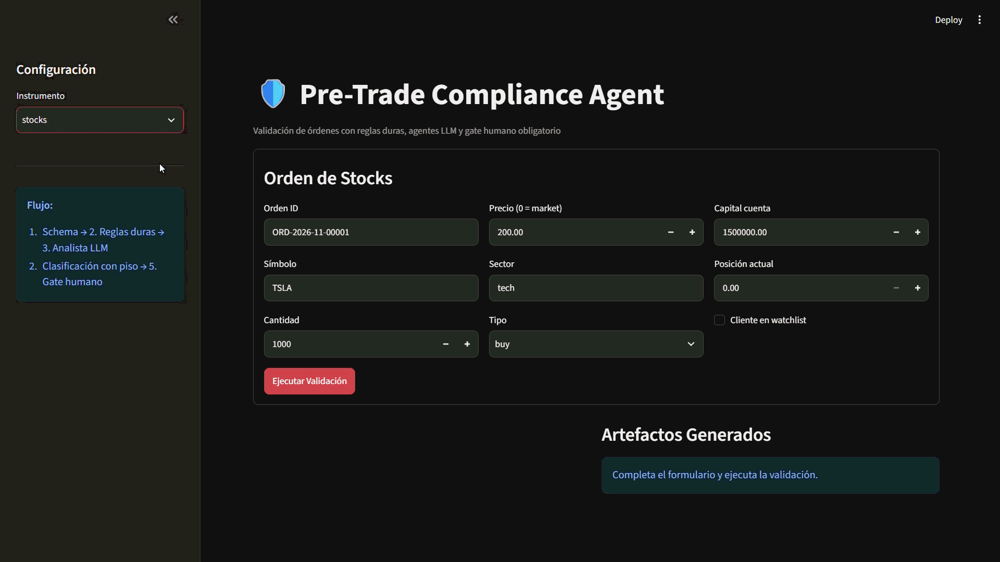
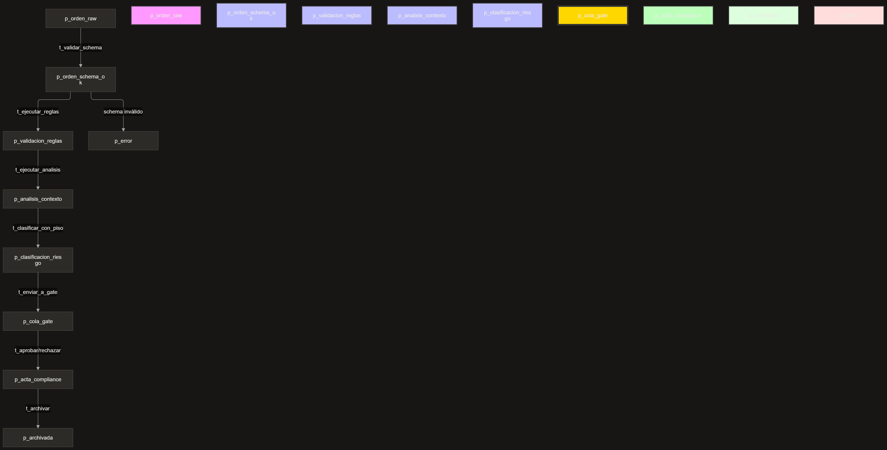

# Pre-Trade Compliance Agent (multi-agent)

> Agentic system for validating financial orders (stocks, forex, crypto,
> futures, options) against deterministic hard rules, bounded LLM agents for
> context analysis, and a mandatory human gate.
> **This system does NOT execute orders; it only audits and recommends.**

[🇪🇸 Leer en español](README.es.md)



## The problem

On institutional desks and brokerages, a Compliance Officer manually reviews
hundreds of orders per day. They must cross-check position limits, restricted
lists, sector concentration, and wash-trading patterns. It is slow (3-5 min
per order), error-prone due to fatigue, and hard to audit consistently.
Moreover, client context (whether they are on a watchlist, whether they show
an unusual pattern) is often overlooked.

## The solution

A **Petri net** engine orchestrates the flow: it pre-filters with hard rules
(deterministic scripts), routes orders that pass the filter through bounded
LLM agents (analyst and writer), and a human (mandatory gate) approves or
rejects. The AI can never override a hard rule.

**Result**: 70% of trivial orders are auto-classified with logging; the
remaining 30% go through LLM agents and the human gate. Time: 30 seconds per
trivial order, 2 minutes per complex order. Risk: consistent, auditable
classification with full traceability.

## 🏗️ Software Architecture

The system is designed under the **"Workflow-oriented multi-agent patterns"** pattern, aligned with industry standards defined by the Microsoft Azure Architecture Center and AWS Prescriptive Guidance.

This pattern is appropriate for processes that require **strict order, business rule compliance, and full auditability**, such as pre-trade validation in financial compliance.

The architecture implements a **deterministic workflow engine** that strictly separates the **control engine** (which dictates which transition executes) from the **business logic** (rules and agents). The flow is deterministic: transitions are enabled by the presence of **permits** in their input stages, and guards decide whether execution is allowed. The AI never controls the flow; it only produces bounded content within a transition.



**Architecture Components:**

- **Workflow Engine (Orchestrator):** The engine that dictates transitions. It is purely deterministic and does not use AI. It models concurrency, resource contention, and deadlocks structurally.
- **Rules Engine (Scripts):** Hard, immutable validations. 25 deterministic rules (5 per instrument) executed without AI intervention.
- **LLM Agents (bounded):** Deterministic functions with an LLM behind them. The **analyst** analyzes unstructured context; the **writer** drafts the compliance memo. Neither has autonomous agency or control of the flow.
- **Classifier (deterministic):** Script that applies the **hard-rule floor** and produces the final classification. It is not an LLM: the AI cannot override the floor.
- **Guards (Guardrails):** Safety controls that validate transitions (hard-rule floor, input hash, gate mutual exclusion, archiving idempotency). Each workflow step has explicit preconditions and postconditions.
- **Human Gate:** Final decision interface with digital signature. Mandatory for risk >= MEDIUM, implementing the *human-in-the-loop* pattern recommended for compliance processes.

### The Agents (LLM via API)

The analysis and writing agents **are not autonomous agents**. They are **deterministic functions with an LLM behind them**, following Anthropic's "workflows" principle: deterministic structure, the LLM does the content work at each step.

#### What does "not autonomous" mean?

In agentic systems, an **autonomous agent** is one that decides what to do next (chooses the next action or tool), can iterate without human intervention, has control of the flow, and can chain multiple calls (tool calling). Examples: a ReAct agent that iterates "think → act → observe" until it solves a task, or a LangChain agent that decides which API to call.

Your agents **do none of that**. They are deterministic functions with an LLM behind them:

| Characteristic | Autonomous agent | Your agent (analyst/writer) |
|:---|:---|:---|
| Does it decide what to do next? | Yes | **No**. The workflow decides. The agent only executes its task when the transition fires. |
| Does it iterate? | Yes (ReAct, tool calling) | **No**. A single HTTP call. If it fails, it retries (up to 3 times), but does not change strategy. |
| Does it control the flow? | Yes | **No**. The workflow engine dictates when it runs and what to do with the output. |
| Does it use tools? | Yes (tool calling) | **No**. It only receives a prompt and returns JSON (analyst) or free text (writer). |
| Can it chain calls? | Yes | **No**. One call per transition. |
| Can it decide to finish? | Yes | **No**. The workflow decides when it finishes (archived, gate, error). |

**Why is this important for compliance?** Because you don't want an LLM deciding the flow. If the agent could decide "I'm going to skip rule R1 because I think it doesn't apply", you would be giving the AI control of a safety-critical decision. That is exactly the anti-pattern this project avoids. By making agents non-autonomous:

1. **The AI only produces content** (an analysis, a memo), not flow decisions.
2. **The deterministic workflow decides** what to do with that content (apply the floor, send to gate, archive).
3. **The floor guard is structural**: even if the agent "suggests" LOW risk, the deterministic script raises it to HIGH if rules failed. The AI cannot override that.

**The analogy**: think of a **junior analyst** on a compliance desk. An autonomous agent would be a junior who decides on their own what to do, who to call, when to escalate (useful, but dangerous in compliance). Your agent is a junior who only does the task you ask (analyze this case, draft this memo) and returns the result to their supervisor (the workflow), who decides what to do with it. The junior has no autonomy to change the process; they only execute their part. That is what makes the system auditable and safe.

#### Technical details

- **Model:** They make a single HTTP call to an OpenAI-compatible provider (default `glm-4.7-flash` via Z.ai, or `deepseek/deepseek-r1:free` via OpenRouter, or `gpt-4o-mini` via OpenAI). The provider is selected with `LLM_PROVIDER` in `.env`.
- **Contract:** The prompt forces the model to return strict JSON (`response_format={"type": "json_object"}`), validated against our Pydantic schema. The writer returns free text (markdown memo), without a structured schema.
- **Decoupling:** The LLM client (`src/agents/llm_client.py`) is isolated. If we migrate to Anthropic, a local model (Llama 3), or Azure OpenAI tomorrow, the workflow engine and guards do not need to change a single line of code.
- **Containment:** The LLM agent only suggests a `riesgo_sugerido_por_agente`. The deterministic script (`clasificar_con_piso_action`) applies the hard-rule floor and produces the final classification. The AI can never lower the risk if rules failed. This follows the "validate the agent output before passing it to the next step" principle recommended by the Azure Architecture Center.

## Design decisions (ADRs)

| ADR | Decision |
|:---|:---|
| [001](docs/adr/001-orquestador-determinista.md) | Deterministic orchestrator instead of an orchestrator agent |
| [002](docs/adr/002-script-vs-agente.md) | Script for base classification, agent only for context |
| [003](docs/adr/003-piso-reglas-duras.md) | Hard-rule floor (AI cannot lower the risk) |
| [004](docs/adr/004-gate-humano.md) | Mandatory human gate and conflict of interest |
| [005](docs/adr/005-artefactos-schema.md) | Artifacts as immutable contracts |
| [006](docs/adr/006-hash-inputs.md) | Input hash to prevent stale approvals |
| [007](docs/adr/007-golden-dataset.md) | Versioned golden dataset |
| [008](docs/adr/008-petri-net-vs-fsm.md) | Petri net instead of FSM for concurrency |
| [009](docs/adr/009-recursos-acotados.md) | Resource pools modeled with tokens |
| [010](docs/adr/010-timeout-y-recarga-rompen-deadlock.md) | Timers that guarantee deadlock-free |

## The 5 instruments (25 hard rules)

The same pattern, 5 variants. Each instrument has 5 deterministic hard rules:

| Instrument | Hard rules | Example case that escalates to gate |
|:---|:---|:---|
| **Stocks** | R1 position 10%, R2 restricted list, R3 sector concentration 25%, R4 wash trading, R5 prohibited sectors | Client requests 15% of a single stock; limit is 10% |
| **Forex** | R1 pair exposure 20%, R2 settlement window, R3 jurisdiction, R4 correlation 40%, R5 counterparty | EUR/USD order outside the settlement window |
| **Crypto** | R1 allowed asset, R2 exchange limit 30%, R3 jurisdiction, R4 regulatory watchlist, R5 minimum liquidity | Client requests to buy a token on the regulatory watchlist |
| **Futures** | R1 available margin, R2 expiry limit, R3 roll restriction, R4 contract limit, R5 market session | Order for 50 contracts when margin only covers 30 |
| **Options** | R1 approval level, R2 allowed strategy, R3 delta limit, R4 naked put level 4+, R5 minimum expiry 7d | Level-2 client requests to sell a naked put (requires level 4) |

## Formal verification (Z3)

`verification/run_verification.py` encodes the network with `z3-solver` and
verifies 5 properties:

```bash
python -m verification.run_verification --net src/petri/definitions.yaml# pretrade-compliance-several-agents
